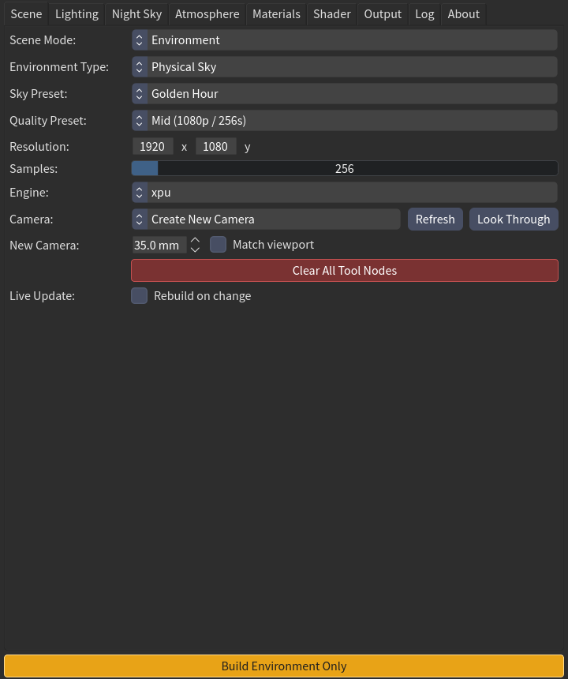

# BSM Karma Builder

BSM Karma Builder is a procedural Python tool for SideFX Houdini (Solaris/LOPs) that builds and updates Karma render setups from one window: camera, lighting, sky, fog, clouds, materials, render variables and render settings. It provides a PySide interface to generate the node networks without manual wiring.



## Why ?

This tool was created to reduce the repetitive reconstruction of node networks for Karma renders, which is frequent during testing and lookdev phases. The beauty of this tool lies in its ability to build and incrementally update the LOP node network without destroying your existing setups: it only ever touches the nodes it created itself.

It also serves as a gateway to simplify the learning curve for Karma and the LOP context, especially for students and Houdini beginners. Unlike classic 3D software where rendering is often just a settings window and a "Render" button, Karma's USD-based approach is fundamentally different and requires foundational knowledge before you can easily render "just for fun".

Please note that this is a first version. While it is not perfect, it represents a solid foundation for a comprehensive Version 2 that is already under active development.

## Features

* **Lighting scenarios**: 1-click generators for Environment, Studio, 3-Point and Interior setups.
* **Karma Physical Sky and HDRI**: sky controls with time-of-day presets (Clear Sky, Golden Hour, Overcast, Night...), a basic or volumetric atmosphere, and HDRI dome setups with exposure, rotation, temperature, tint and a thumbnail preview.
* **Fog and clouds**: atmospheric fog (`karmafogbox`), procedural 3D volume clouds, or a fast **2D cloud layer** (a generated picture on a second dome light) for distant backgrounds.
* **Shader**: sixteen basic materials of the tool (plastic, metal, glass, skin with subsurface, fabric...) to click or drag onto prims, the **PBR** general purpose material (a Principled-like MaterialX material with slots for a whole texture set: base color, roughness, metalness, normal OpenGL or DirectX, AO, displacement, emission, opacity), a **Random** material (a new color and finish for each selected prim, from hue, saturation and brightness ranges), and a simple editor for the material of a prim (color, roughness, subsurface, glass, coat, sheen, emission, texture tint and tiling) that works on a copy of the MaterialX file.
* **Materials**: browse a MaterialX catalog as thumbnails, a list or categories; assign a material to prims by drag and drop (on the prim list or on the Solaris viewport) or with **Assign Material to Selection**; right click a material to edit it in the Material Linker or open it as a MaterialX node network.
* **Material downloads**: a built-in window downloads free MaterialX materials from ambientCG and Poly Haven (the AMD MaterialX Library is a catalog source). Nothing to install.
* **Render settings and quality presets**: Draft to Ultra resolutions and sample counts, Karma CPU and XPU.
* **AOV management**: Standard Render Vars with predefined passes and a multilayer or split output.
* **Live Update**: optionally see value changes in the network without pressing Build. Changes that add or remove nodes wait for the button, so a running Karma viewport is not restarted behind your back.
* **Safe rebuilds**: nodes are marked, updated in place and never deleted or rewired unless the tool created them. Cooking is paused during a build.
* **Debug log**: everything the tool does goes to a text file you can send when something fails.

## Requirements

* SideFX Houdini 21 or 22. Houdini 22 parameter names are the reference and older names are tried as fallbacks; the log lists any parameter that a version does not have. Earlier versions are not supported.
* Solaris (LOPs) context and Karma rendering engine.

## Installation

It needs nothing but Houdini: no pip, no extra Python, and you never paste code. Pick one way.

| Way | Good for | What you get |
|---|---|---|
| [A. Install.bat](#a-installbat-windows-recommended) | Windows, most people and the development setup | The menu **BSM > Karma Builder** and a **BSM Karma** shelf, loaded at every start |
| [B. Package file](#b-package-file-linux-macos-or-by-hand) | Linux, macOS, or Windows by hand | The same as A, with one small file written by you |
| [C. The HDA](#c-the-hda) | A single file to hand over | A **BSM Karma Builder** node (Tab menu in `/stage`) that opens the window |

### A. Install.bat (Windows, recommended)

1. Get the repository: clone it, or download it as a zip and unpack it somewhere you will keep it, for example `D:\Documents\Coding\Houdini Scripts\Karma-builder`.
2. Double-click **Install.bat** at the root of that folder. Windows may show "Windows protected your PC": click **More info**, then **Run anyway**. The file only starts `tools\install_windows.ps1`, which you can read first.
3. It finds your Houdini 21 and 22 preferences folders (`Documents\houdini21.0`, `Documents\houdini22.0`...) and writes one file in each: `packages\bsm_karma.json`. That file points Houdini at the folder of the repository. Nothing is copied.
4. Restart Houdini. The main menu has a new **BSM** menu: **BSM > Karma Builder** opens the window. The shelf **BSM Karma** is available too (the **+** at the right of the shelf tabs, then **BSM Karma**).

To update: get the new version of the folder (pull or unpack over it). Pressing the menu item reloads the code, so Houdini does not need a restart. If you move or rename the folder, run **Install.bat** again from its new place. **Uninstall.bat** removes the package file again and leaves the folder alone.

An older copy installed by `bsm_karma.install()` (`scripts/python/bsm_karma` and `toolbar/bsm_karma.shelf`) is renamed to `.old` by Install.bat, so that Houdini does not load two versions.

If Houdini keeps its preferences somewhere other than `Documents\houdini22.0`, open PowerShell in the folder and run `tools\install_windows.ps1 -PrefsDir "C:\path\to\houdini22.0"`.

### B. Package file (Linux, macOS or by hand)

Create `packages/bsm_karma.json` in your Houdini preferences folder (`~/houdini22.0` on Linux, `~/Library/Preferences/houdini/22.0` on macOS, `Documents\houdini22.0` on Windows) with this content, the path being the folder of the repository (twice):

```json
{
    "enable": true,
    "path": "/home/you/Karma-builder",
    "env": [
        { "PYTHONPATH": { "method": "prepend", "value": "/home/you/Karma-builder" } }
    ]
}
```

Restart Houdini: the menu **BSM > Karma Builder** appears. Do not also keep a copy of `bsm_karma` in `scripts/python`: Houdini would load one of them and you would not know which.

### C. The HDA

An HDA is one file that carries the whole tool.

1. Build it from the repository with Houdini's command-line Python (`hython`). On Windows, in PowerShell, from the folder of the repository:

   ```powershell
   & "C:\Program Files\Side Effects Software\Houdini 22.0.466\bin\hython.exe" .\build_hda.py
   ```

   Replace the Houdini folder with yours. It prints `built ... bsm_karma_builder.hda (tool version ..., ... KB)` and writes `bsm_karma_builder.hda` next to the script. Linux and macOS: run `hython build_hda.py` from a terminal where `houdini_setup` has been sourced. The HDA holds a copy of the code, so build it again after every update. It is built with the Houdini that runs `hython`: to use it in both 21 and 22, build it with 21.
2. Make Houdini load it: copy the file to `$HOUDINI_USER_PREF_DIR/otls/` (create the folder if needed), then restart Houdini. Or use **Assets > Install Asset Library...** and pick the file. Do not install two copies of the asset. `$HOUDINI_USER_PREF_DIR` is the preferences folder, for example `D:/Documents/houdini22.0`.
3. In a `/stage` network, press **Tab** and type `karma builder` (it is in the **BSM** submenu). Press **Open Karma Builder** on the node.
4. Optional: press **Create Shelf Button** on the node. It creates the shelf **BSM Karma** with a button that opens the tool through the asset.

The asset never creates a shelf or a menu by itself, that is what the button and A are for. If the node is missing from the Tab menu, restart Houdini and check, in the Python Shell, `hou.nodeType(hou.lopNodeTypeCategory(), "bsm::karma_builder::1.0")`: it returns `None` when the asset is not loaded. If it is loaded and the Tab menu still does not list it, create the node from the Python Shell with `hou.node("/stage").createNode("bsm::karma_builder::1.0")`. An HDA built before 2026.10.16 has an older Tab menu definition: build it again.

### D. Advanced

* From the Python Shell, with the repository on the path, `bsm_karma.install()` copies the package to `scripts/python` and writes the shelf. It is meant for people who cannot use a package file. Only one of A and this should be used.
* Working from a checkout without installing: in the Python Shell, `import sys; sys.path.insert(0, r"<folder of the repository>"); import bsm_karma; bsm_karma.main()`.

### Which build is running?

Every build of the tool has an id: 8 characters computed from the source of all its modules. It changes with any change of the code, and it is the same for the same code, wherever it runs from (a folder, `scripts/python` or the HDA). You find it:

* in the **title of the window**: `BSM Karma Builder 1.0.0 (build a1b2c3d4, folder)`. The last word says where the code was loaded from: `folder` (the repository), `installed` (the copy in `scripts/python`) or `HDA`;
* in the first line of the **Log** and in the debug log;
* in the Python Shell: `import bsm_karma; print(bsm_karma.build_info())`;
* on the **HDA node**, the **Build** line under its parameters: the build that was compiled into the asset.

To know whether that is the code of the repository you think you have, run on the repository (Python only, no Houdini needed):

```powershell
python tools/build_id.py
```

It prints `build a1b2c3d4 | version ... | 33 modules | ...`. Same id as the window: same code. A different id means Houdini runs another copy: an older `scripts/python` copy, an old HDA, or a package file pointing elsewhere. Run Install.bat again, or rebuild the HDA, then restart the tool and compare again. The version number alone is not enough: it only changes when I bump it, the id changes with every edit.

### First start

1. Click the button (or **Open Karma Builder** on the node). The window **BSM Karma Builder** opens.
2. Press **Build Environment Only**. The nodes appear in `/stage`.
3. Everything the tool does is written in `bsm_karma_debug.log`; the Log tab shows the path. Send that file when something goes wrong.

### Troubleshooting

| Symptom | Cause and fix |
|---|---|
| `ModuleNotFoundError: No module named 'bsm_karma'` | The folder is not in `scripts/python` of the preferences of the Houdini you are running (21 and 22 have separate folders), or it is one level too deep. Check with `print(hou.text.expandString("$HOUDINI_USER_PREF_DIR"))`. |
| The window does not open and the Python Shell shows an error | Copy the error. A missing `presets.json` is a common cause: copy the whole folder, not only the `.py` files. |
| The shelf is not in the shelf bar | **+** at the right of the shelf tabs, then **BSM Karma**. Or restart Houdini. |
| The HDA runs another build than the repository | Check which file Houdini loaded: `d = hou.nodeType(hou.lopNodeTypeCategory(), "bsm::karma_builder::1.0").definition()`, then `print(d.libraryFilePath())` and `print([n for n in d.sections() if "buildinfo" in n])`. An empty list means that asset was compiled before the build id existed: compile again and install that file (the path printed is the one in use: delete or replace it). The HDA window title ends with `HDA`; if it ends with `folder`, you opened the tool from the repository (the shelf button or `bsm_karma.main()`), not from the asset. |
| The old version still runs | Two copies exist (for example `scripts/python` and a package file), or an old HDA is installed. Keep one. Rebuild the HDA after an update. |
| `bsm_karma.install()` says the preferences folder is unknown | Houdini could not expand `$HOUDINI_USER_PREF_DIR`. Use way B (the package file). |
| The HDA node is not in the Tab menu | Restart Houdini, check that the file is in `otls`, and create the node from the Python Shell (B, step 3). |
| Houdini 21 and 22 both used | Install once for each: they do not share a preferences folder. |

More in the [documentation](docs/index.html#troubleshooting).

### Uninstall

Run **Uninstall.bat** (or delete `packages/bsm_karma.json` in the preferences folder). If you used `bsm_karma.install()`, also delete, in `$HOUDINI_USER_PREF_DIR`: `scripts/python/bsm_karma` (and `bsm_karma.bak`, `bsm_karma.old`), `toolbar/bsm_karma.shelf`, `otls/bsm_karma_builder.hda` if you installed the asset, and the folder `bsm_karma` (debug log, 2D cloud pictures, downloaded materials, icon). Restart Houdini.

## Usage

1. Use the menu **BSM > Karma Builder**, the shelf tool, or **Open Karma Builder** on the HDA node to open the window.
2. In the `Scene` tab, define the scene mode, camera, engine, resolution and quality.
3. Use the `Lighting` and `Atmosphere` tabs for the sky or HDRI, the fog and the clouds.
4. Use the `Materials` tab to pick a material (or download one) and assign it to the prims of a Geometry Source.
5. Adjust the `Render` and `Passes` (AOV) tabs as needed.
6. Click **Build Environment Only** to generate the LOP network, or use the render buttons of the `Export` tab to render to MPlay or to disk.


## Material sources

The Materials tab reads catalogs; the **Download...** button there fetches free MaterialX materials without any extra install, lists them with thumbnails, and lets you drag a material onto a prim of the list or onto an object of the Solaris viewport (or tick *Assign to the selected prims when a download ends*). Check the licence of what you use.

| Source | Address | Where in the tool |
|---|---|---|
| AMD MaterialX Library (about 290 materials) | site `https://matlib.gpuopen.com`, API `https://api.matlib.gpuopen.com/api` | Materials tab, Source **AMD MaterialX Library**, then **Connect** |
| ambientCG | `https://ambientcg.com` | **Download...** window |
| Poly Haven | `https://polyhaven.com/textures` | **Download...** window |
| MaterialX project (example materials) | `https://github.com/AcademySoftwareFoundation/MaterialX` | **USD / MaterialX File...** source, or **Assign File...** |

The AMD source asks Houdini for a download folder, not an address (default `$HOUDINI_USER_PREF_DIR/bsm_karma/materials`). The tool checks that the server answers before connecting, so an offline machine does not freeze Houdini.

## Documentation

The full documentation (interface reference with screenshots, what is built, presets, building the HDA, tests, safety checks, troubleshooting) is in [`docs/index.html`](docs/index.html). GitHub shows HTML files as source: download the repository and open the file in a browser, or serve the `docs` folder with GitHub Pages.

## Credits

The material downloads follow the requests of the open source [materialxmaterials](https://pypi.org/project/materialxmaterials/) tool (Bernard Kwok, Apache 2.0), without using its code. The materials come from [AMD GPUOpen](https://matlib.gpuopen.com), [ambientCG](https://ambientcg.com) and [Poly Haven](https://polyhaven.com/textures), under their own terms.

## Author

BSM

## Website

The `website/` folder holds the site of the tool (home, user guide, FAQ, contact form, private statistics) in plain PHP with SQLite. See [website/README.md](website/README.md) to install it.

## License

Licensed under the [PolyForm Noncommercial License 1.0.0](LICENSE): free for personal, educational and any other noncommercial use. Studios and commercial use need a commercial license, see [Informations/COMMERCIAL_LICENSE.txt](Informations/COMMERCIAL_LICENSE.txt). Versions published before 30 September 2026 were released under GPL-3.0.
