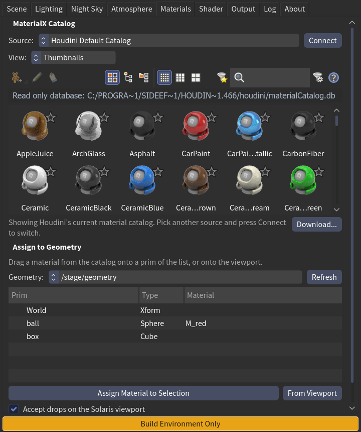

<p align="center"></p>

# Karma Builder

A Python tool for Houdini (Solaris) that builds and updates a Karma render setup from one window: camera, lights, sky, fog, clouds, materials, AOVs and render settings.


## Why

I got tired of rebuilding the same node networks every time I tested a render or did some lookdev. The tool builds the LOP network for me and updates it afterwards. It only touches the nodes it created itself, so my own setups stay as they are.

It also helps students and beginners. In a classic 3D package, rendering is often a settings window and a button. Karma works on USD, and you need some basics before you can render anything just for fun.

This is still version 1, and I am working on version 2.

## What it does

* Lighting setups in one click: environment, studio, 3-point, interior.
* Karma Physical Sky with time of day presets and a basic or volumetric atmosphere, or an HDRI dome with exposure, rotation, temperature, tint and a preview.
* Exact sky: the sun, the moon (position, phase, parallax), the five naked eye planets and the stars are placed for a date, a time (UT) and a latitude and longitude. The precision is a few arc minutes for the sun and the planets and about two for the moon. `tests/test_ephemeris.py` checks it against dated events.
* Night sky: a textured moon with its halo and a phase slider, the stars of the Yale Bright Star Catalogue as real points, and the Milky Way. They show when the sun is below -3 degrees and replace the day sky at -12.
* Sky composite: the sky layers can be added after the render instead of being built in the scene. The tool renders with depth, draws the sky for the render camera and puts it under the geometry in a Copernicus network (`/obj/karma_sky_comp`). The output is then EXR, and these layers do not show in the Karma viewport. What you add to the network stays.
* Fog and clouds: atmospheric fog, procedural volume clouds, or a much faster 2D cloud layer for the distance.
* Shaders: sixteen basic materials to click or drag onto prims, a general PBR material with texture slots, a random material (one colour and finish per selected prim) and a small editor that works on a copy of the MaterialX file.
* MaterialX materials: browse a catalogue, assign by drag and drop on the prim list or the viewport, edit in the Material Linker or open as a node network.
* Downloads of free materials from ambientCG and Poly Haven, from inside the tool.
* Render presets from Draft to Ultra, Karma CPU and XPU, standard AOVs, multilayer or split output.
* Live Update for value changes. Changes that add or remove nodes wait for the Build button, so a running viewport is not restarted.
* A debug log of everything the tool does.



## Requirements

Houdini 21 or 22, with Solaris and Karma. Parameter names follow Houdini 22, older names are tried as fallbacks and the log lists what a version does not have. Earlier versions are not supported.

## Installation

You only need Houdini: no pip, no extra Python, nothing to paste. Use one of the three ways below.

### A. Install.bat (Windows)

1. Clone or download the repository and put the folder somewhere it will stay.
2. Double-click `Install.bat`. If Windows says it protected your PC, click More info, then Run anyway. The file only starts `tools\install_windows.ps1`.
3. It writes `packages\bsm_karma.json` in the preferences folder of each Houdini 21 and 22 it finds. This file points to the repository, nothing is copied.
4. Restart Houdini. Open the tool from the menu BSM > Karma Builder, or from the Karma Builder shelf (the + at the right of the shelf tabs).

To update, replace the folder content and click the menu item again: the code is reloaded. If you move the folder, run `Install.bat` again. An older copy installed in `scripts/python` is renamed to `.old`.

If your preferences are not in `Documents`:

```powershell
tools\install_windows.ps1 -PrefsDir "C:\path\to\houdini22.0"
```

### B. Package file (Linux, macOS, or by hand)

Create `packages/bsm_karma.json` in the preferences folder (`~/houdini22.0` on Linux, `~/Library/Preferences/houdini/22.0` on macOS, `Documents\houdini22.0` on Windows). The path of the repository appears twice:

```json
{
    "enable": true,
    "path": "/home/you/Karma-builder",
    "env": [
        { "PYTHONPATH": { "method": "prepend", "value": "/home/you/Karma-builder" } }
    ]
}
```

Restart Houdini. Do not keep another copy of `bsm_karma` in `scripts/python`.

### C. HDA

One file that carries the whole tool.

1. Build it with `hython`, from the repository folder (adapt the Houdini path):

   ```powershell
   & "C:\Program Files\Side Effects Software\Houdini 22.0.466\bin\hython.exe" .\build_hda.py
   ```

   On Linux and macOS, run `hython build_hda.py` after sourcing `houdini_setup`. Build again after each update. To use the asset in both 21 and 22, build it with 21.
2. Copy `bsm_karma_builder.hda` into the `otls` folder of your preferences and restart Houdini, or use Assets > Install Asset Library. Install only one copy.
3. In `/stage`, press Tab, type `karma builder` and press Open Karma Builder on the node. Create Shelf Button adds a shelf button if you want one.

If the node is not in the Tab menu, restart Houdini, or create it from the Python Shell:

```python
hou.node("/stage").createNode("bsm::karma_builder::1.0")
```

### From the Python Shell

`bsm_karma.install()` copies the package to `scripts/python` and writes the shelf, for those who cannot use a package file. Do not combine it with A. To run the tool from a checkout without installing it:

```python
import sys; sys.path.insert(0, r"<repository folder>"); import bsm_karma; bsm_karma.main()
```

## First start

1. Open the window.
2. In the Scene tab, choose the scene mode, camera, engine, resolution and quality.
3. Set the sky, moon, stars, fog and clouds in the Lighting, Night Sky and Atmosphere tabs.
4. Assign materials in the Materials tab.
5. Check the Render and Passes pages of the Output tab.
6. Click Build Environment Only to create the network in `/stage`, or render to MPlay or to disk from the Export page.

If something fails, send me `bsm_karma_debug.log`. The Log tab shows where it is.

## Which build is running

Each build has an 8 character id computed from the source, so it changes with any edit, even when the version number does not. It is written at the top of each session in the debug log, with where the code was loaded from (`folder`, `installed` or `HDA`), and on the HDA node. You can also ask Houdini:

```python
import bsm_karma; print(bsm_karma.build_info())
```

Compare it with the id of the repository (no Houdini needed):

```powershell
python tools/build_id.py
```

If they differ, Houdini is running another copy. Run `Install.bat` again or rebuild the HDA.

## Troubleshooting

* `ModuleNotFoundError: No module named 'bsm_karma'`: the folder Houdini looks into is wrong (21 and 22 have separate preferences), or the package is one level too deep. `print(hou.text.expandString("$HOUDINI_USER_PREF_DIR"))` shows the preferences folder.
* The window does not open: read the error in the Python Shell. A missing `presets.json` often means only the `.py` files were copied. Copy the whole folder.
* The shelf is missing: use the + at the right of the shelf tabs, or restart Houdini.
* The old version still runs: there are two copies, or an old HDA. Keep one, and rebuild the HDA after an update.
* The HDA runs another build: this shows which file Houdini loaded.

  ```python
  d = hou.nodeType(hou.lopNodeTypeCategory(), "bsm::karma_builder::1.0").definition()
  print(d.libraryFilePath())
  ```

* `bsm_karma.install()` cannot find the preferences folder: use the package file (B).

More in the [documentation](docs/index.html#troubleshooting).

## Uninstall

Run `Uninstall.bat`, or delete `packages/bsm_karma.json`. If you used `bsm_karma.install()` or the HDA, also delete these in the preferences folder: `scripts/python/bsm_karma` (and its `.bak` and `.old`), `toolbar/bsm_karma.shelf`, `otls/bsm_karma_builder.hda` and the `bsm_karma` folder (log, cloud pictures, downloaded materials, icon). Restart Houdini.

## Material sources

Check the licence of what you use.

| Source | Address | In the tool |
|---|---|---|
| AMD MaterialX Library | `https://matlib.gpuopen.com` (API `https://api.matlib.gpuopen.com/api`) | Materials tab, source AMD MaterialX Library, then Connect |
| ambientCG | `https://ambientcg.com` | Download window |
| Poly Haven | `https://polyhaven.com/textures` | Download window |
| MaterialX example materials | `https://github.com/AcademySoftwareFoundation/MaterialX` | USD / MaterialX File source, or Assign File |

The AMD source asks for a download folder (by default `$HOUDINI_USER_PREF_DIR/bsm_karma/materials`) and checks that the server answers before it connects.

## Documentation

The full documentation is in [`docs/index.html`](docs/index.html). GitHub shows it as source, so download the repository and open it in a browser.

The `website/` folder holds the site of the tool, in PHP and SQLite: see [website/README.md](website/README.md).

## Credits

The downloads follow the requests of [materialxmaterials](https://pypi.org/project/materialxmaterials/) (Bernard Kwok, Apache 2.0), without using its code. The materials come from [AMD GPUOpen](https://matlib.gpuopen.com), [ambientCG](https://ambientcg.com) and [Poly Haven](https://polyhaven.com/textures), under their own terms.

## Author

BSM

## License

Licensed under the [PolyForm Noncommercial License 1.0.0](LICENSE): free for personal, educational and any other noncommercial use. Studios and commercial use need a commercial license (testing in a studio is free, with no time limit), see [Informations/COMMERCIAL_LICENSE.txt](Informations/COMMERCIAL_LICENSE.txt). Versions published before 30 September 2026 were released under GPL-3.0.
